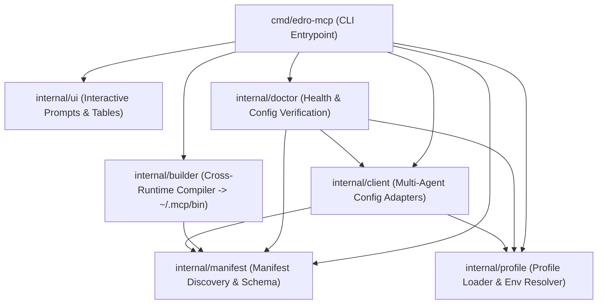

# Architecture Specification — edro-mcp

## 1. Overview
`edro-mcp` is a language-agnostic monorepo of Model Context Protocol (MCP) servers paired with a zero-dependency Go CLI installer, builder, and multi-agent profile synchronizer.

The architecture cleanly separates two concerns:
1. **Self-Contained MCP Servers** (`database/mysql`, `database/postgresql`, and future servers): Each server maintains its own isolated runtime/module (`go.mod`, `pyproject.toml`, `package.json`, etc.) and exposes a declarative `mcp.manifest.json` contract.
2. **Unified CLI Installer & Profile Manager** (`go.mod` at repository root, entrypoint at `cmd/edro-mcp`): A pure standard-library Go CLI that discovers manifests, compiles/installs binaries into `~/.mcp/bin/`, manages multi-instance connection profiles (`profiles.json`), and non-destructively merges server configurations into global AI client files (Antigravity, OpenCode, Codex, Claude Code, Cursor).



---

## 2. Repository Layout & Package Boundaries

The root `go.mod` defines module `edro-mcp` using **Go standard library only** (`flag`, `encoding/json`, `os`, `os/exec`, `path/filepath`, `bufio`, `strings`, `regexp`, `text/tabwriter`, `context`). Sub-directories `database/mysql` and `database/postgresql` retain their own independent `go.mod` files so Go automatically excludes nested modules from the root module graph while keeping each MCP server independently buildable.

| Module / Path | Responsibility | Allowed Dependencies |
| :--- | :--- | :--- |
| `go.mod` (root) | Root Go module (`module edro-mcp`) for the CLI tool | Go standard library only |
| `cmd/edro-mcp` | Thin CLI entrypoint: subcommand routing (`install`, `sync`, `build`, `list`, `doctor`), flag parsing, context lifecycle, and exit codes | `internal/*`, Go stdlib |
| `internal/manifest` | Recursive discovery of `mcp.manifest.json`, schema validation, and runtime token interpolation (`{bin_dir}`, `{exe_ext}`, `{mcp_dir}`) | Go stdlib |
| `internal/profile` | Loading/saving `profiles.json` & `profiles.example.json`, default profile generation from manifests, required env validation, and `{env:VAR_NAME}` resolution policies (`auto`, `literal`, `keep`) with secret masking for `--dry-run` | `internal/manifest`, Go stdlib |
| `internal/builder` | Execution of manifest build strategies (`go`, `command`, `copy`) with `context.Context` and atomic binary installation into `~/.mcp/bin/` | `internal/manifest`, Go stdlib |
| `internal/client` | Adapter interface, client auto-detection, `.bak` backup creation, atomic writes, and format-preserving merge engines for JSON (`antigravity`, `claude`, `cursor`), JSONC (`opencode`), and TOML (`codex`) | `internal/manifest`, `internal/profile`, Go stdlib |
| `internal/ui` | Interactive terminal checklists/prompts (`stdin`/`stdout`) in Spanish, tabular summary rendering, and `--json` output formatting | `internal/manifest`, `internal/profile`, `internal/client`, Go stdlib |
| `internal/doctor` | Verification of installed binaries in `~/.mcp/bin/`, profile env completeness, and syntax/entry validation across detected client configs | `internal/manifest`, `internal/profile`, `internal/client`, Go stdlib |
| `install.ps1` / `install.sh` | Optional thin bootstrap scripts at repo root that build `cmd/edro-mcp` into `~/.mcp/bin/edro-mcp` and forward CLI arguments | `go` toolchain |
| `database/mysql` | Independent Go module (`module mysql`) + `mcp.manifest.json` | Standard library + MySQL driver + MCP SDK |
| `database/postgresql` | Independent Go module (`module postgresql`) + `mcp.manifest.json` | Standard library + pgx driver + MCP SDK |

---

## 3. Core Component Contracts

### 3.1 `internal/manifest`
- **Discovery (`Discover(rootDir string) ([]Manifest, error)`)**:
  - Walks `rootDir` via `filepath.WalkDir`, skipping `.git`, `agents`, `internal`, `cmd`, `node_modules`, and hidden directories.
  - Parses every `mcp.manifest.json` file, records its directory (`Dir`), validates `schemaVersion == "1.0"`, non-empty `id`, `runtime`, `build.type`, and `run.command`, and checks for duplicate `id` values.
- **Token Interpolation (`ResolveCommand(binDir string, goos string) (string, []string)`)**:
  - Replaces `{bin_dir}` with ` filepath.ToSlash(binDir)` or native OS path via `filepath.Clean`, `{exe_ext}` with `.exe` when `goos == "windows"` (empty string otherwise), and `{mcp_dir}` with the manifest directory.

### 3.2 `internal/profile`
- **Precedence & Fallback (`Load(explicitPath, repoRoot, homeDir string) (*Config, string, error)`)**:
  1. Explicit `--config <path>` flag.
  2. `<repoRoot>/profiles.json` (gitignored local file).
  3. `<homeDir>/.mcp/profiles.json` (global user profile store).
  4. Fallback template `<repoRoot>/profiles.example.json`.
- **Default Profile Synthesis**:
  - When `--mcps` specifies an MCP ID that has no entry in `profiles.json`, synthesizes an in-memory profile named `<mcp.ID>` populated with each manifest env variable's `default` value.
- **Environment Variable Resolution (`ResolveEnv(rawEnv map[string]string, clientID string, policy ResolvePolicy, lookupEnv func(string) (string, bool)) (resolved map[string]string, masked map[string]string, warnings []string)`)**:
  - Recognizes canonical `{env:VAR_NAME}` references.
  - Under `policy == "auto"`:
    - `opencode`: keeps `"{env:VAR_NAME}"` literally.
    - `claude`: converts to `"${VAR_NAME}"`.
    - `antigravity`, `codex`, `cursor`: looks up `VAR_NAME` via `lookupEnv`; if defined and non-empty, injects the value into `resolved` and records `"<resolved from $VAR_NAME>"` in `masked` (used by `--dry-run` and console logs so secrets are never printed); if undefined, preserves `"{env:VAR_NAME}"` and appends a Spanish warning message.
  - Under `policy == "literal"`: resolves `{env:VAR_NAME}` from `lookupEnv` for all clients.
  - Under `policy == "keep"`: preserves `"{env:VAR_NAME}"` (or `"${VAR_NAME}"` for Claude) without expanding host environment variables.

### 3.3 `internal/builder`
- **Build Execution (`Build(ctx context.Context, m manifest.Manifest, binDir string, dryRun bool) (BuildResult, error)`)**:
  - Ensures `binDir` (`~/.mcp/bin`) exists with `0o755` permissions.
  - Deduplicates builds by manifest `id` so multiple profiles sharing the same MCP compile the binary only once per invocation.
  - For `build.type == "go"`: runs `exec.CommandContext(ctx, "go", "build", "-o", outputBinaryPath, m.Build.Source)` with `cmd.Dir = m.Dir`.
  - For `build.type == "command"`: runs `m.Build.Command` in `m.Dir` and verifies/copies the resulting binary to `outputBinaryPath`.
  - Sets executable permissions (`0o755`) on POSIX systems.

### 3.4 `internal/client` (Multi-Agent Config Adapters)
All 5 supported clients implement a common `Adapter` contract:
```go
type Entry struct {
    ProfileName string
    Command     string
    Args        []string
    Env         map[string]string
}

type SyncResult struct {
    ClientID    string
    ConfigPath  string
    BackupPath  string
    Profiles    []string
    Created     bool
    DryRunDiff  string
    Warnings    []string
}
```

- **Safe File Mutation Protocol**:
  1. Read existing file if present. If the file exists and `--dry-run` is false, write an exact byte copy to `<ConfigPath>.bak` (`0o600`).
  2. Ensure parent directories exist (`os.MkdirAll(filepath.Dir(ConfigPath), 0o755)`).
  3. Merge only the target `<profile_name>` entries into the client's native schema while preserving all unrelated top-level settings and third-party MCP servers.
  4. Write atomically via a temporary sibling file (`<ConfigPath>.tmp`) with `0o600` permissions followed by `os.Rename` (with Windows fallback overwrite handling).

- **Format-Specific Merge Engines (Stdlib Only)**:
  - **Standard JSON (`antigravity` at `~/.gemini/config/mcp_config.json`, `claude` at `~/.claude.json`, `cursor` at `~/.cursor/mcp.json`)**:
    - Unmarshals existing file into `map[string]any` (initializing an empty map if file does not exist).
    - Reads or creates `"mcpServers"` as `map[string]any`.
    - Sets `mcpServers[profileName]` to the client-specific object (`claude` includes `"type": "stdio"`; `antigravity` and `cursor` include `"command"`, `"args"`, `"env"`).
    - Marshals with `json.MarshalIndent(..., "", "  ")` + trailing newline.
  - **JSON with Comments (`opencode` at `~/.config/opencode/opencode.jsonc`)**:
    - Implements a lexer-aware JSONC sanitizer (`stripJSONC`) that strips `//` line comments, `/* ... */` block comments, and trailing commas outside string literals so `encoding/json` can parse existing `opencode.jsonc` files into `map[string]any` without syntax errors.
    - Preserves leading header comments (`// ...` or `/* ... */` at the top of the file) when re-serializing, keeps all existing root keys (`$schema`, `theme`, `model`, `provider`, etc.) and existing entries under `"mcp" -> "servers"`, and injects each profile under `mcp.servers[profileName]` with:
      - `"type": "local"`
      - `"command": [command, ...args]`
      - `"environment": envMap`
  - **TOML (`codex` at `~/.codex/config.toml`)**:
    - Implements a dedicated, line-oriented TOML section parser/merger in `internal/client/toml.go` that preserves comments, root keys (`model`, `approval_policy`, etc.), and unrelated sections (`[mcp_servers.other]`, `[projects...]`).
    - For each synced `<profile_name>`, replaces any existing `[mcp_servers.<profile_name>]` and `[mcp_servers.<profile_name>.env]` blocks (quoting keys when needed if they contain dashes or special characters, or using standard bare keys `[mcp_servers.mysql-local]` since TOML bare keys allow `A-Za-z0-9_-`) and writes deterministic TOML strings with `strconv.Quote` and sorted env keys.

---

## 4. Dependency Direction & Composition Rules
- **Strict Acyclic Graph**:
  - `internal/manifest` has zero internal dependencies.
  - `internal/profile` depends only on `internal/manifest`.
  - `internal/builder` depends only on `internal/manifest`.
  - `internal/client` depends only on `internal/manifest` and `internal/profile`.
  - `internal/doctor` and `internal/ui` coordinate `manifest`, `profile`, and `client`.
  - `cmd/edro-mcp` wires flags, `context.Context`, and subcommands together.
- **Error Handling & Logging**:
  - Follow `edro-dev-go`: wrap errors with `fmt.Errorf("...: %w", err)`, lowercase error messages without trailing punctuation, never ignore errors silently, and never log or print raw credential values.

---

## 5. Portability & Security Contracts
1. **Zero Hardcoded Host Paths**:
   - No source file, test fixture, manifest, profile template, or documentation may contain host-specific paths (drive letters, `/Users/...`, `/home/...`).
   - All user paths (`~/.mcp/bin`, `~/.gemini/config/mcp_config.json`, `~/.config/opencode/opencode.jsonc`, `~/.codex/config.toml`, `~/.claude.json`, `~/.cursor/mcp.json`) are resolved dynamically via `os.UserHomeDir()` (or overridden in unit tests via injectable home/root directories).
2. **Secret Hygiene**:
   - `.gitignore` at the repository root must ignore `/profiles.json`, `*.bak`, `*.exe`, and compiled binaries (`edro-mcp`, `mysql-mcp`, `postgresql-mcp`).
   - `--dry-run` output masks any value resolved from host environment variables (`<resolved from $VAR_NAME>`) and masks variables marked `"sensitive": true` in the manifest if literal values are present.
